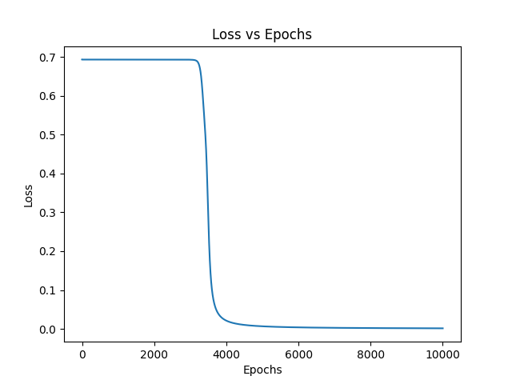

# xor-neural-network

A small neural network built from scratch with NumPy, with no deep learning library, that learns the **XOR** (exclusive or) function.

I built it while working through IBM's deep learning labs on forward propagation, activation functions and backpropagation. The goal was to understand every step by writing it myself, and to check that the gradients are correct.

## What it does

XOR outputs 1 only when its two inputs differ:

| x1 | x2 | output |
|----|----|--------|
| 0  | 0  | 0 |
| 0  | 1  | 1 |
| 1  | 0  | 1 |
| 1  | 1  | 0 |

No single straight line separates the 1s from the 0s, so a model without a hidden layer cannot learn it. A network with one hidden layer can.

## The network

- **Architecture:** 2 inputs, 2 hidden neurons, 1 output
- **Activation:** sigmoid on both layers
- **Loss:** binary cross-entropy
- **Training:** full-batch gradient descent, learning rate 1, 10,000 epochs
- **Initialization:** small random weights (seeded), zero biases

Everything is written as plain functions in the notebook:

| Function | Purpose |
|----------|---------|
| `initialize_parameters` | creates the starting weights and biases |
| `sigmoid` | activation function |
| `forward` | forward propagation through both layers |
| `compute_loss` | binary cross-entropy |
| `backprop` | gradients of the loss for every weight and bias |
| `update_parameters` | one gradient descent step |

The gradients were verified against a numerical (finite difference) check, and they agreed to about 7 significant digits.

## Results

After 10,000 epochs the network classifies all four inputs correctly:

| Input | Label | Prediction |
|-------|-------|------------|
| (0, 0) | 0 | 0.002 |
| (0, 1) | 1 | 0.999 |
| (1, 0) | 1 | 0.999 |
| (1, 1) | 0 | 0.001 |

The loss curve has a clear shape. It stays flat at about 0.693 (the loss of always answering 0.5) for roughly the first 3,000 epochs, then drops sharply once the hidden neurons find a useful split, and keeps shrinking slowly after that.



## Project structure

```
xor-neural-network/
├── notebooks/
│   ├── xor_network.ipynb   # the whole project, run top to bottom
│   └── loss_curve.png      # loss plot saved by the notebook
├── requirements.txt
├── LICENSE
└── README.md
```

## Getting started

Tested with Python 3.11.

```bash
git clone https://github.com/mohammadSous/xor-neural-network.git
cd xor-neural-network

python -m venv .venv
# Windows (PowerShell):
.venv\Scripts\Activate.ps1
# macOS / Linux:
# source .venv/bin/activate

pip install -r requirements.txt
```

Then open `notebooks/xor_network.ipynb` in VS Code (with the Jupyter extension) or JupyterLab, select the `.venv` interpreter, and run all cells.

## Ideas for next steps

- Compare different learning rates and random seeds, and see how the length of the plateau changes
- Use more hidden neurons
- Replace the hidden sigmoid with tanh or ReLU
- Generalize the code to any number of layers
